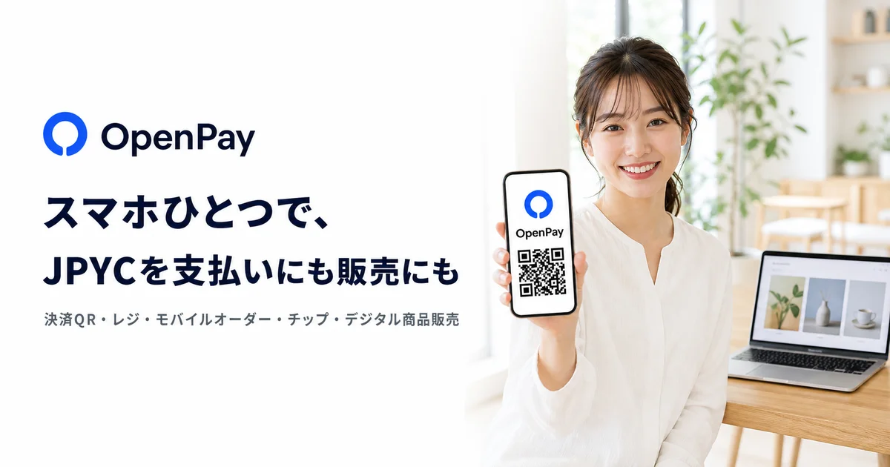
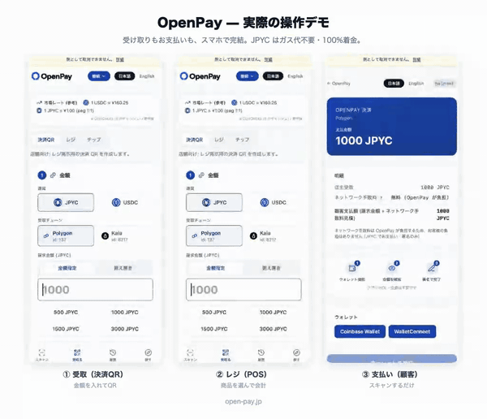

# OpenPay

OpenPay is a **non-custodial QR payment tool** that turns JPYC / USDC wallet transfers into a simple checkout for stores, events, creators, and AI agents.

OpenPay は、JPYC / USDC のウォレット送金を、店舗・イベント向け QR 決済体験に変えるノンカストディ型 OSS 決済ツールです。

**Demo**: <https://open-pay.jp> · **Status**: Beta · **License**: MIT



**Live demo (mobile) — receive / register / pay · 実際の操作（受取・レジ・支払い）**



## Key features

- **Non-custodial, no wallet lock-in** — payments go directly to the merchant wallet; OpenPay never holds funds.
  Any wallet that signs standard ERC20 / ERC-4337 / EIP-7702 transactions can pay, and no app install is required.
- **JPYC / USDC with QR-locked conditions** — amount, token, chain, and recipient are pinned per QR; customers cannot mistype them.
- **Standard or gasless payment** — Standard: the customer pays gas in the native token.
  Gasless: the customer pays with just the token. For JPYC, OpenPay sponsors the gas and charges a small per-transaction usage fee, and it **works in any wallet**.
  For USDC, gas is paid in USDC via the paymaster **but only for EIP-7702 smart-account wallets — ordinary wallets fall back to standard**.
- **Receive, register and history** — a QR builder (`/create`), a mobile-friendly simple register with an itemized cart, a block explorer link on every receipt,
  per-browser local history (`/history`) with accounting-software CSV export, and a printable store kit (`/kit`).
- **Mobile order & `@handle` storefronts** *(live in production)* — a store publishes a menu at `open-pay.jp/@handle` (or shares a `/order` link); customers browse, add to a cart, and pay by QR.
  Order relay to the merchant and kitchen / hall boards are flag-gated layers.
- **Tips and permanent `@handle` links** — a tip widget (link or embed) for creators and a link-in-bio profile that keeps resolving however often the receiver changes; `@handle` is **live on mainnet**.
- **Notifications, PWA and offline receive QR** *(live in production)* — Web Push when a payment lands, an installable app, and a receive screen whose last QR keeps working with no signal.
- **x402 / AI-agent payments** *(live in production)* — a managed **JPYC x402 facilitator**, a public **AI store** (`/discovery`), and the `openpay-x402-mcp` MCP package.
  Most x402 servers are USDC-only; OpenPay adds **JPYC**, and its USDC APIs accept **Base and Arc**.
- **OSS, self-hostable** under MIT.

Full feature list: [docs/FEATURES.md](./docs/FEATURES.md).

**日本語の概要**: 店舗は、金額・トークン・チェーン・受取先を固定した QR を作るだけで、お客様のウォレットから直接入金を受け取れます（アカウント登録は不要・OpenPay は資金を預かりません）。
JPYC はどのウォレットでもガス代なしで支払えます（USDC のガス代なし決済は EIP-7702 スマートアカウントのウォレットのみで、通常のウォレットは通常決済になります）。
JPYC のガス代なし決済では、お店側に 1 回ごとの OpenPay 利用料がかかります（詳しくは [Fees](#fees)）。
機能の全文は [docs/FEATURES.md](./docs/FEATURES.md) にあります。

## Fees

In **gasless** mode for **JPYC** (recover configuration), each payment carries a **per-transaction OpenPay usage fee** — **1% of the payment with a 2 JPYC minimum** (`max(2 JPYC, 1%)`).
The fee is deducted at settlement and split to the OpenPay fee-receiver atomically in the same transaction.
For **payments** (`/pay`, `/checkout`, the register) the **merchant always absorbs the fee** and the **customer pays exactly the displayed price**.
OpenPay never takes custody: the principal price of goods still moves customer→merchant directly on-chain, and only the usage-fee portion is split out.

For **tips** (`/tip`, `@handle` tip pages) the **tipper pays a flat gas-equivalent floor (about 2 JPYC)** on top of the tip — the **1% does not apply to tips**.

There are **no OpenPay usage fees** on receiving a payment itself, on **standard** (with-gas) mode outside mobile orders — including the register's standard JPYC path since 2026-10-07
(the customer pays their own gas, OpenPay does not touch it), or on the **USDC** paths outside mobile orders
(gas is paid by the customer in USDC via the Pimlico / Circle paymaster, or directly on Arc; OpenPay collects 0).
The usage fee applies to JPYC gasless (recover) payments and tips, plus mobile orders described below.
“The shop pays the gas” (register or a fixed-amount payment QR shown on screen, JPYC on Polygon, Kaia or Avalanche; flag-gated) carries no OpenPay usage fee —
the shop’s device pays the gas and, by design, 1 wei is added to the customer’s payment and sent to OpenPay.

- **Mobile-order system fee** *(live in production)* — payments made through a mobile-order storefront (`@handle` / `/order`) carry the OpenPay usage fee at a **mobile-order rate**:
  **1%** for in-store / kiosk (`storefront`) and **3%** for pre-order mobile ordering (`preorder`), a flat percent (no floor).
  On a mobile order only this rate applies (it is not charged in addition to the gasless per-tx usage fee), and it applies on both the gasless relay and standard (with-gas) mode.
  `/pay`, tips, and ordinary checkout links are unaffected.
- **Digital goods store** *(live in production)* — selling digital items on `@handle` profiles carries **no seller fee**; the buyer pays the listed price plus the **x402 facilitator fee** (1% of price, min 1 JPYC) added on the buyer side.

This pricing is **not a percentage skim of arbitrary size**: it is a small, capped, per-transaction service fee for the gas-sponsored JPYC relay.
OpenPay remains a non-custodial software / infrastructure provider rather than a payment intermediary under the Japanese Payment Services Act framework.
Full details (fee bearer, Arc, register history): [docs/FEATURES.md#fees](./docs/FEATURES.md#fees).

## Supported tokens and chains

| Token | Merchant receiving chains | Notes |
|---|---|---|
| **JPYC** (v3) | Polygon, Kaia, Avalanche C-Chain | Gasless via OpenPay's self-hosted **EIP-3009 relayer** (signature-based, no EIP-7702 needed). **Ethereum L1** is also supported but **standard-mode only**, behind a default-off flag. |
| **USDC** (Circle native — bridged USDC.e is **not** supported) | Base, Arbitrum, Optimism, Polygon, Ethereum L1, Avalanche C-Chain (standard-mode only for now), Arc (7 with Arc enabled; standard-mode only) | Gasless via the Pimlico ERC20 Paymaster or **Circle Paymaster v0.8**. **USDC gasless requires the buyer's EOA to be an EIP-7702 smart account; ordinary / undelegated wallets fall back to standard payment.** |

- USDC balances are chain-specific. Customers can pay from **11 chains** via Circle Gateway / CCTP V2 cross-chain, and need the source chain's native gas (ETH/POL etc.) for a cross-chain payment.
- `NEXT_PUBLIC_NETWORK_ENV=testnet` swaps mainnets for the matching testnets.
- Per-chain details, the payment-page chain chooser, and the tip widget: [docs/FEATURES.md](./docs/FEATURES.md#supported-tokens-and-chains).

## Non-custodial design and beta notice

OpenPay **never holds** merchant funds. Customer payments are sent **directly to the merchant wallet**. OpenPay does **not** issue, redeem, custody, or exchange JPYC / USDC.

OpenPay is **beta software**. Test with small amounts first. Blockchain transactions are **irreversible** — there is no chargeback.
Always verify recipient address, token, chain, amount, and final receipt.
Merchants should verify actual receipt in their wallet or on a block explorer, even after the completion screen is shown.

OpenPay はベータ版です。まず少額でお試しください。ブロックチェーンの送金は取り消せません（チャージバックはありません）。
送金先・トークン・チェーン・金額を必ず確認し、受け取り側もウォレットやブロックエクスプローラーで入金を確認してください。
Known limitations: [docs/FEATURES.md#limitations](./docs/FEATURES.md#limitations).

## Quick start

### For merchants

Just visit <https://open-pay.jp>, enter your wallet, and generate a QR. No signup.

### For developers (self-host)

**One-click deploy** — spin up your own instance on Vercel:

[](https://vercel.com/new/clone?repository-url=https%3A%2F%2Fgithub.com%2Fcipherwebllc%2Fopenpay&env=NEXT_PUBLIC_NETWORK_ENV,NEXT_PUBLIC_PIMLICO_API_KEY&envDescription=Network%20env%20plus%20optional%20gasless%2FKV%20keys%3B%20see%20.env.local.example&envLink=https%3A%2F%2Fgithub.com%2Fcipherwebllc%2Fopenpay%2Fblob%2Fmain%2F.env.local.example)

It **boots on testnet by default**, and receiving payments works out of the box.
**Gasless** (Pimlico) and the **KV-backed** features (SIWE / billing / payment log) need their own keys.
For **mainnet**, also set `NEXT_PUBLIC_NETWORK_ENV=mainnet` + `NEXT_PUBLIC_FEE_RECEIVER_ADDRESS` + per-chain RPC + Sentry.
Self-hosting on Netlify / Railway / any Node host works too.

Or run locally:

```bash
git clone https://github.com/cipherwebllc/openpay
cd openpay
npm install
cp .env.local.example .env.local       # fill in values
npm run dev                            # http://localhost:3000
```

```bash
npm run typecheck
npm run lint
npm run test:run
npm run build
npm run e2e:local                      # Playwright with stub env
```

- Environment variables: [docs/ENV.md](./docs/ENV.md) (a curated table); every key is in [`.env.local.example`](./.env.local.example).
- Operator runbook: [docs/DEPLOY_CHECKLIST.md](./docs/DEPLOY_CHECKLIST.md) · monitoring notes: [docs/OPERATIONS.md](./docs/OPERATIONS.md).

## For AI agents (x402)

OpenPay includes **experimental** x402 protocol support for per-request paid API endpoints (AI agent / API use cases — separate from the human checkout flow).
Every USDC-priced API on open-pay.jp answers `402` with **two ways to pay the same price: USDC on Base, or USDC on [Arc](https://www.arc.io/)** (`eip155:5042`), live on Arc mainnet since 2026-09-17.
See it without a wallet:

```bash
curl -si https://open-pay.jp/api/paid/hello | grep -i '^payment-required:' | cut -d' ' -f2 | base64 -d
# → accepts: [ eip155:8453 (USD Coin), eip155:5042 (GatewayWalletBatched) ] — same amount, same payee
```

OpenPay also runs a managed **JPYC x402 facilitator** and a public catalog (`/discovery`), and offers the Japan Web3 Directory API and the JPYC Shops API.

- Endpoints, prices, and the buyer example: [docs/API.md](./docs/API.md)
- Rules for listing a paid resource: [docs/LISTING_POLICY.md](./docs/LISTING_POLICY.md)
- MCP package: [`packages/x402-mcp`](./packages/x402-mcp) · SDK: [`packages/x402-sdk`](./packages/x402-sdk)
- Catalogue: [`/openapi.json`](https://open-pay.jp/openapi.json) · [`/llms.txt`](https://open-pay.jp/llms.txt)

## Legal / disclaimer

OpenPay is **not** a wallet, exchange, custodian, or redemption provider. Users are responsible for complying with applicable laws and regulations in their jurisdiction.

- [Terms of Service / 利用規約](https://open-pay.jp/ja/terms)
- [Privacy Policy / プライバシーポリシー](https://open-pay.jp/ja/privacy)
- [Disclaimer / 免責事項](https://open-pay.jp/ja/disclaimer)
- [特定商取引法に基づく表記](https://open-pay.jp/ja/tokutei)

## Contact

Want to build OpenPay's payment stack (JPYC/USDC payments, AI-agent payments) into your own service? Reach us on the [OpenPay Discord](https://discord.gg/Cfywb3aNWg), or add a message to a JPYC tip from the "Support" section of [@cipherweb](https://open-pay.jp/en/@cipherweb) (only the recipient can read it).

OpenPay の仕組み（JPYC・USDC 決済、AI エージェントの支払い）を自社のサービスに組み込みたい方は、[OpenPay の Discord](https://discord.gg/Cfywb3aNWg) か、[@cipherweb のページ](https://open-pay.jp/ja/@cipherweb)の「応援する」からメッセージを添えてご相談ください（読めるのは本人だけです）。

## License

MIT. Self-hosting and forking are fully permitted under MIT. The OpenPay brand and the `open-pay.jp` domain belong to the operator and are not part of the license grant.

---

Changelog: [CHANGELOG.md](./CHANGELOG.md) · Operator deploy guide: [docs/DEPLOY_CHECKLIST.md](./docs/DEPLOY_CHECKLIST.md)
